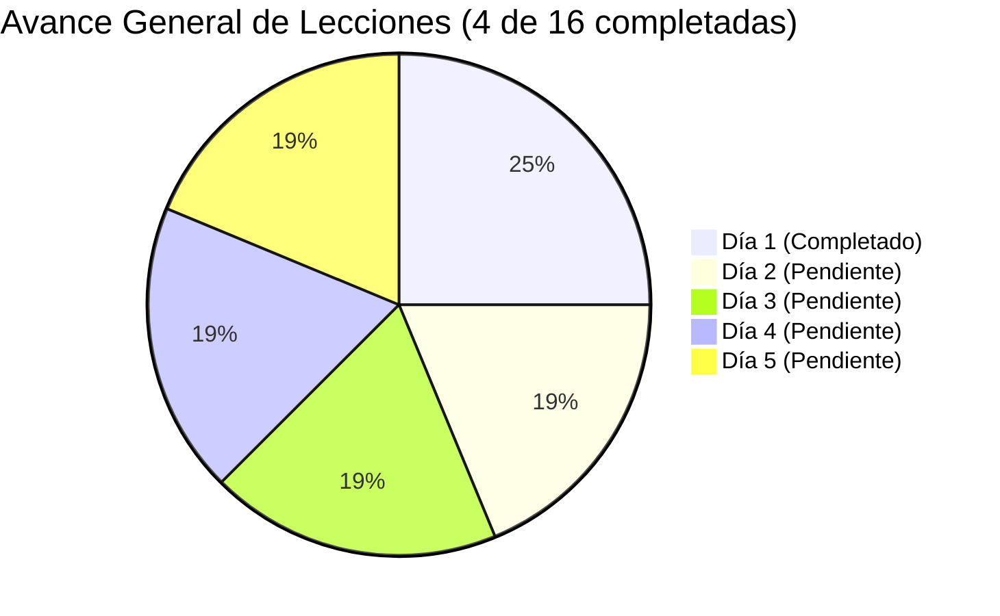

# ⚡ Circuitos Eléctricos I y II: Repaso Intensivo (Mecatrónica)

> **Ruta de Repaso de 5 Días** enfocada quirúrgicamente en dominar los fundamentos de circuitos eléctricos de corriente continua (CD), alterna (CA) y transitorios para sentar las bases analíticas de **Electrónica I y II** (polarización de transistores BJT/MOSFET, amplificadores operacionales, redes de acoplamiento y fuentes reguladas).

---

## 📌 Índice de Navegación

* [📊 Estado General del Progreso](#-estado-general-del-progreso)
* [🗺️ Índice de Clases y Ruta Temática](#️-índice-de-clases-y-ruta-temática)
  * [Día 1: Fundamentos de Circuitos CD (✅ Listo)](#-día-1-fundamentos-de-circuitos-cd)
  * [Día 2: Divisores y Redes de Polarización (⏳ En cola)](#-día-2-divisores-de-tensióncorriente-y-redes-de-polarización-resistiva)
  * [Día 3: Teoremas de Redes (⏳ Pendiente)](#-día-3-teoremas-de-redes-thévenin-norton-y-transferencia-de-potencia)
  * [Día 4: Régimen Sinusoidal y Fasores en CA (⏳ Pendiente)](#-día-4-régimen-sinusoidal-y-análisis-fasorial-en-ca)
  * [Día 5: Transitorios RC y RL de Primer Orden (⏳ Pendiente)](#-día-5-circuitos-transitorios-de-primer-orden-rc-y-rl-y-respuesta-temporal)
* [🛠️ Laboratorio Digital: Simuladores Interactivos](#️-laboratorio-digital-simuladores-interactivos)
* [📂 Estructura del Repositorio](#-estructura-del-repositorio)
* [📚 Fuentes de Consulta y Cuaderno NotebookLM](#-fuentes-de-consulta-y-cuaderno-notebooklm)

---

## 📊 Estado General del Progreso



* **Progreso Global:** 25% completado (Día 1 finalizado).
* **Control detallado:** Consulta el registro continuo en [`task.md`](./task.md).
* **Guía de estilo y sistema:** Especificaciones docentes en [`system_prompt.md`](./system_prompt.md).

---

## 🗺️ Índice de Clases y Ruta Temática

### ✅ Día 1: Fundamentos de Circuitos CD
> **Objetivo:** Dominar la relación tensión-corriente-resistencia mediante la Ley de Ohm, leyes de conservación de Kirchhoff y planteamiento sistemático (matricial) de corrientes de malla y tensiones de nodo.

| # | Lección | Documento de Estudio | Simulador Interactivo |
| :---: | :--- | :---: | :---: |
| **01** | Ley de Ohm y Fundamentos de Resistencia Equivalente | [📄 `01_ley_de_ohm.md`](./docs/day_01/01_ley_de_ohm.md) | [🎮 Simulador Serie-Paralelo](./apps/01_serie_paralelo/index.html) |
| **02** | Ley de Corrientes de Kirchhoff (LCK) y Conservación de Carga | [📄 `02_LCK.md`](./docs/day_01/02_LCK.md) | [🎮 Simulador LCK de Nodo](./apps/02_lck/index.html) |
| **03** | Ley de Tensiones de Kirchhoff (LVK) y Conservación de Energía | [📄 `03_LVK.md`](./docs/day_01/03_LVK.md) | [🎮 Simulador LVK de Malla](./apps/03_lvk/index.html) |
| **04** | Método de Corrientes de Malla y Regla de Cramer (Matricial) | [📄 `04_mallas.md`](./docs/day_01/04_mallas.md) | [🎮 Simulador Matricial de Mallas](./apps/04_mallas/index.html) |

---

### ⏳ Día 2: Divisores de Tensión/Corriente y Redes de Polarización Resistiva
> **Objetivo:** Calcular redes divisoras y simplificaciones serie-paralelo para entender cómo se fijan tensiones de polarización de base/compuerta en transistores y etapas discretas.

| # | Lección | Documento de Estudio | Estado |
| :---: | :--- | :---: | :---: |
| **01** | Análisis de circuitos serie-paralelo y reducción de redes resistivas | `docs/day_02/01_serie_paralelo.md` | ⏳ Pendiente |
| **02** | Divisores de tensión y cálculo de caídas de voltaje en polarización | `docs/day_02/02_divisor_tension.md` | ⏳ Pendiente |
| **03** | Divisores de corriente para el reparto de intensidades en ramas | `docs/day_02/03_divisor_corriente.md` | ⏳ Pendiente |

---

### ⏳ Día 3: Teoremas de Redes (Thévenin, Norton y Transferencia de Potencia)
> **Objetivo:** Reducir circuitos lineales complejos a modelos equivalentes de fuente real ($V_{TH}, R_{TH}$) para aislar y conectar etapas amplificadoras y calcular máxima transferencia de potencia.

| # | Lección | Documento de Estudio | Estado |
| :---: | :--- | :---: | :---: |
| **01** | Teorema de Thévenin y cálculo de equivalentes en terminales de carga | `docs/day_03/01_thevenin.md` | ⏳ Pendiente |
| **02** | Teorema de Norton y transformación de fuentes reales ($V \leftrightarrow I$) | `docs/day_03/02_norton.md` | ⏳ Pendiente |
| **03** | Acoplamiento de impedancias y teorema de máxima transferencia de potencia | `docs/day_03/03_maxima_potencia.md` | ⏳ Pendiente |

---

### ⏳ Día 4: Régimen Sinusoidal y Análisis Fasorial en CA
> **Objetivo:** Manejar números complejos y la identidad de Euler para modelar en régimen permanente senoidal redes con componentes reactivos ($L, C$).

| # | Lección | Documento de Estudio | Estado |
| :---: | :--- | :---: | :---: |
| **01** | Señales sinusoidales y representación fasorial con identidad de Euler | `docs/day_04/01_fasores.md` | ⏳ Pendiente |
| **02** | Impedancias complejas de $R$, $L$ y $C$ en corriente alterna | `docs/day_04/02_impedancia.md` | ⏳ Pendiente |
| **03** | Análisis de circuitos fasoriales y cálculo de desfases en redes pasivas | `docs/day_04/03_analisis_ca.md` | ⏳ Pendiente |

---

### ⏳ Día 5: Circuitos Transitorios de Primer Orden ($RC$ y $RL$) y Respuesta Temporal
> **Objetivo:** Evaluar la evolución temporal ante conmutaciones escalón, calculando la constante de tiempo ($\tau = RC$, $\tau = L/R$) para filtrado y respuesta transitoria.

| # | Lección | Documento de Estudio | Estado |
| :---: | :--- | :---: | :---: |
| **01** | Constante de tiempo $\tau$ en circuitos $RC$ y $RL$ de primer orden | `docs/day_05/01_constante_tiempo.md` | ⏳ Pendiente |
| **02** | Solución analítica a la respuesta al escalón (procesos de carga y descarga) | `docs/day_05/02_carga_descarga.md` | ⏳ Pendiente |
| **03** | Comportamiento temporal en acoplamientos capacitivos y filtrado de señales | `docs/day_05/03_filtrado_acoplamiento.md` | ⏳ Pendiente |

---

## 🛠️ Laboratorio Digital: Simuladores Interactivos

Cada lección incluye un simulador web autónomo en **HTML5/JS** (sin dependencias externas), ejecutable directamente en cualquier navegador moderno:

1. **[Simulador de Circuito Serie-Paralelo](./apps/01_serie_paralelo/index.html):**  
   Permite variar fuentes de tensión y valores resistivos para observar reducciones en tiempo real y perfiles de corriente.
2. **[Simulador de LCK en Nodo](./apps/02_lck/index.html):**  
   Simula la conservación de carga con corrientes entrantes y salientes ajustables y comprobación dinámica de la sumatoria $\sum I = 0$.
3. **[Simulador de LVK en Malla](./apps/03_lvk/index.html):**  
   Modela elevaciones y caídas de tensión alrededor de una trayectoria cerrada con verificación gráfica de $\sum V = 0$.
4. **[Simulador Matricial de Corrientes de Malla](./apps/04_mallas/index.html):**  
   Resuelve el sistema matricial $2 \times 2$ mediante determinantes (Regla de Cramer), mostrando corrientes ficticias de malla y la corriente real en ramas compartidas.

---

## 📂 Estructura del Repositorio

```text
01_Circuitos/
├── index.html             # Portal web principal interactivo (GitHub Pages / Local)
├── README.md              # Índice principal y guía de navegación rápida
├── content.md             # Contenido programático oficial (5 días de repaso)
├── system_prompt.md       # Reglas pedagógicas, flujo de trabajo y plantilla Cornell-Kwik
├── task.md                # Bitácora de seguimiento de tareas y lecciones
├── docs/                  # Lecciones teóricas en Markdown
│   ├── day_01/            # Lecciones completas del Día 1
│   │   ├── 01_ley_de_ohm.md
│   │   ├── 02_LCK.md
│   │   ├── 03_LVK.md
│   │   └── 04_mallas.md
│   └── day_02/            # En desarrollo
└── apps/                  # Simuladores web interactivos (HTML/JS)
    ├── 01_serie_paralelo/
    │   └── index.html
    ├── 02_lck/
    │   └── index.html
    ├── 03_lvk/
    │   └── index.html
    └── 04_mallas/
        └── index.html
```

---

## 📚 Fuentes de Consulta y Cuaderno NotebookLM

Toda la base bibliográfica formal (Boylestad, Hayt & Kemmerly, Dorf & Svoboda) está centralizada en el cuaderno de **NotebookLM**:

* **Cuaderno:** Circuitos Eléctricos
* **ID:** `71f7e159-394a-4421-bb9c-608a1d697562`
* **Fuentes cargadas:** 14 fuentes teóricas y ejercicios de referencia.

---

## 🚀 Demos en Vivo (Simuladores Web)

| Lección | Guía de Estudio | Demo Online (HTMLPreview) |
| :--- | :---: | :---: |
| **01: Ley de Ohm y Serie-Paralelo** | [📄 `01_ley_de_ohm.md`](./docs/day_01/01_ley_de_ohm.md) | [🎮 Probar Simulador](https://htmlpreview.github.io/?https://github.com/wplanchez/01_Circuitos/blob/main/apps/01_serie_paralelo/index.html) |
| **02: Ley de Corrientes de Kirchhoff (LCK)** | [📄 `02_LCK.md`](./docs/day_01/02_LCK.md) | [🎮 Probar Simulador](https://htmlpreview.github.io/?https://github.com/wplanchez/01_Circuitos/blob/main/apps/02_lck/index.html) |
| **03: Ley de Tensiones de Kirchhoff (LVK)** | [📄 `03_LVK.md`](./docs/day_01/03_LVK.md) | [🎮 Probar Simulador](https://htmlpreview.github.io/?https://github.com/wplanchez/01_Circuitos/blob/main/apps/03_lvk/index.html) |
| **04: Corrientes de Malla (Matricial)** | [📄 `04_mallas.md`](./docs/day_01/04_mallas.md) | [🎮 Probar Simulador](https://htmlpreview.github.io/?https://github.com/wplanchez/01_Circuitos/blob/main/apps/04_mallas/index.html) |

